## 👀 raspberry-pi5_ai-hat_display-module2 Overview  
This setup provides a complete system configuration for Raspberry Pi 5 with AI HAT and touchscreen module, featuring touch right-click emulation, a customized persistent virtual keyboard, a quick brightness/sleep control panel, and stable PCIe AI accelerator startup optimizations

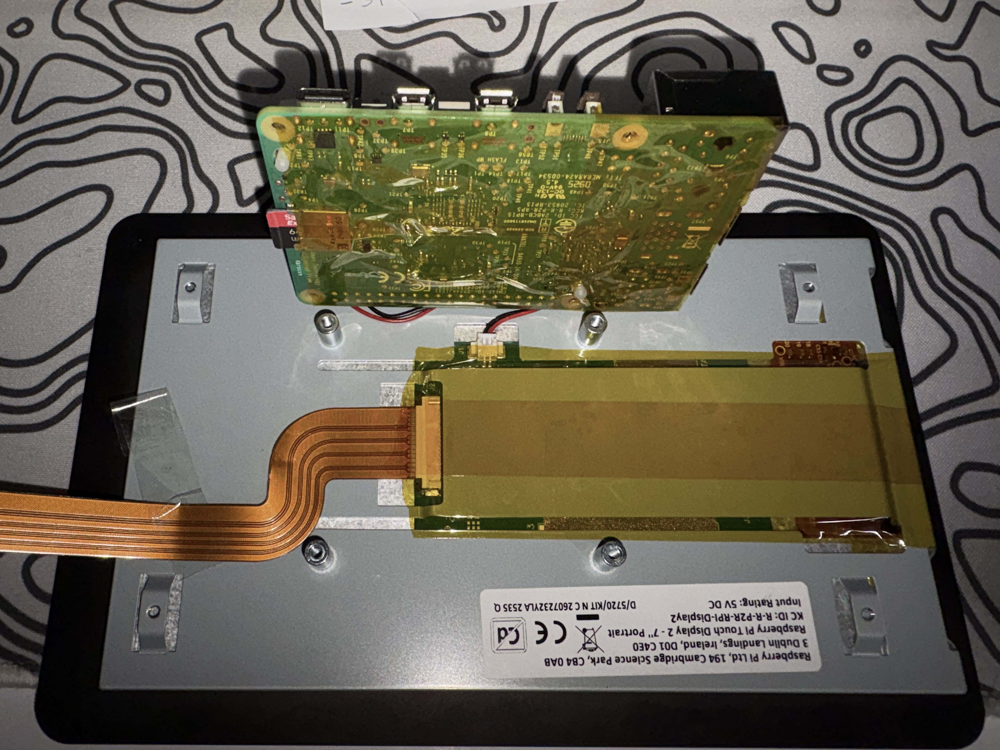

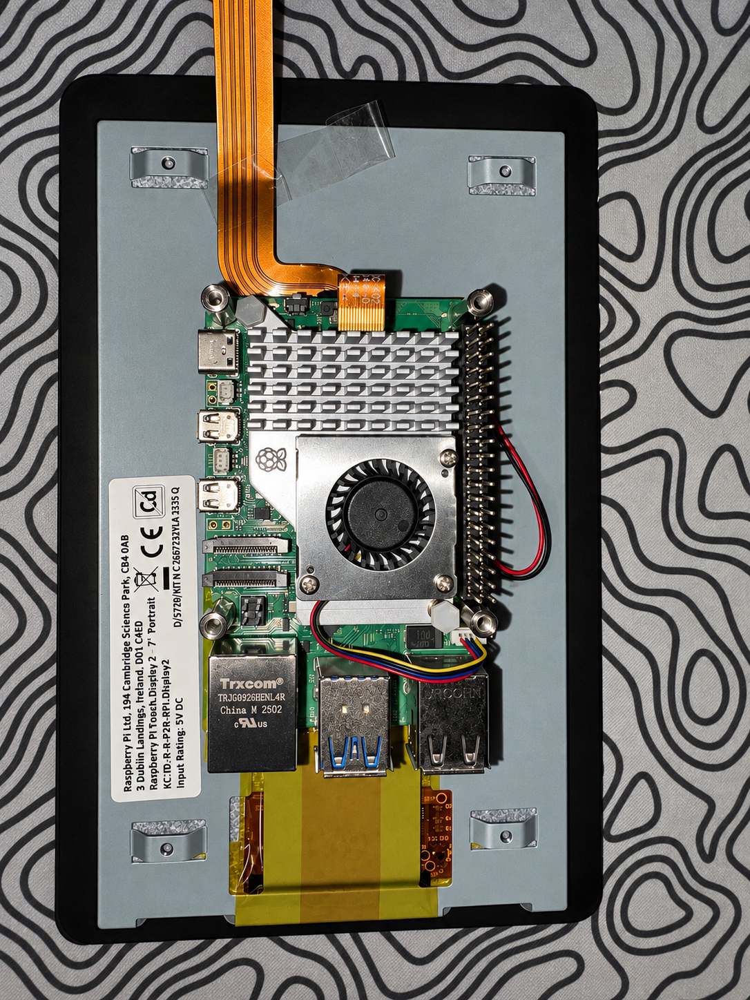

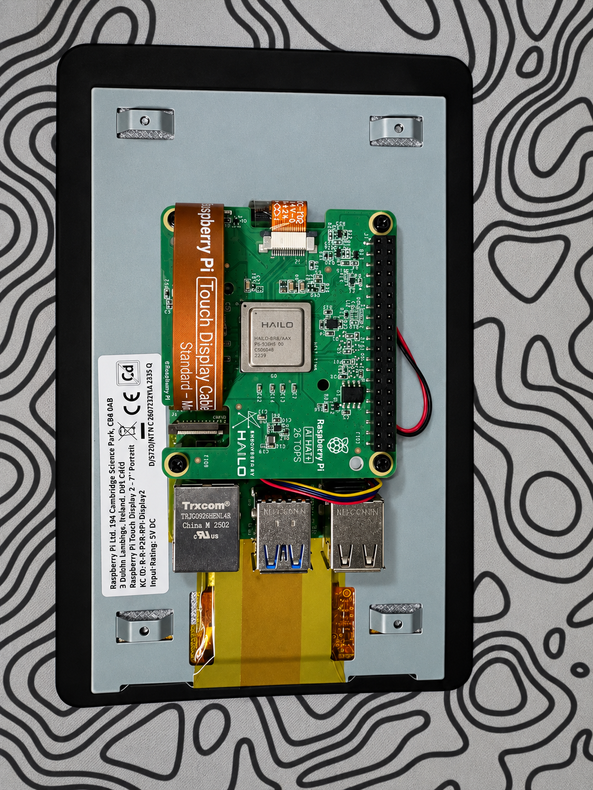

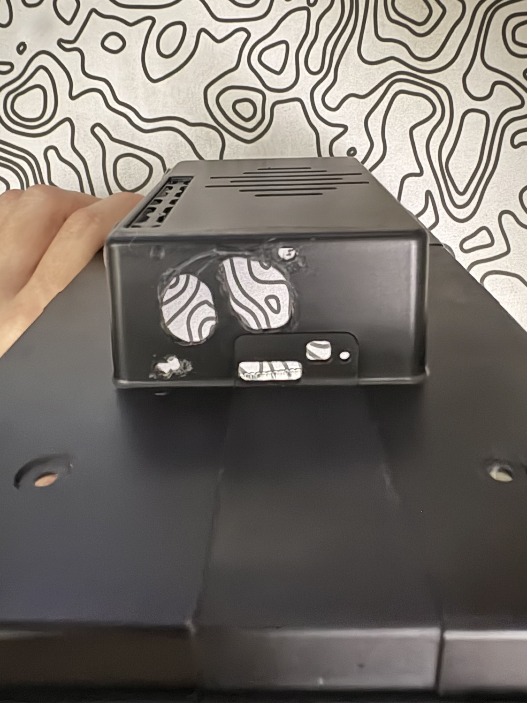

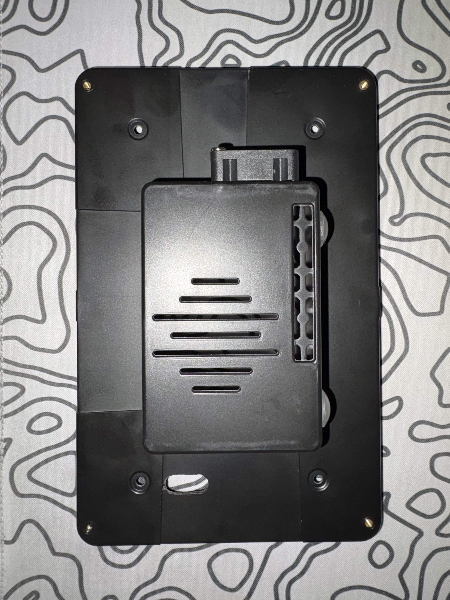

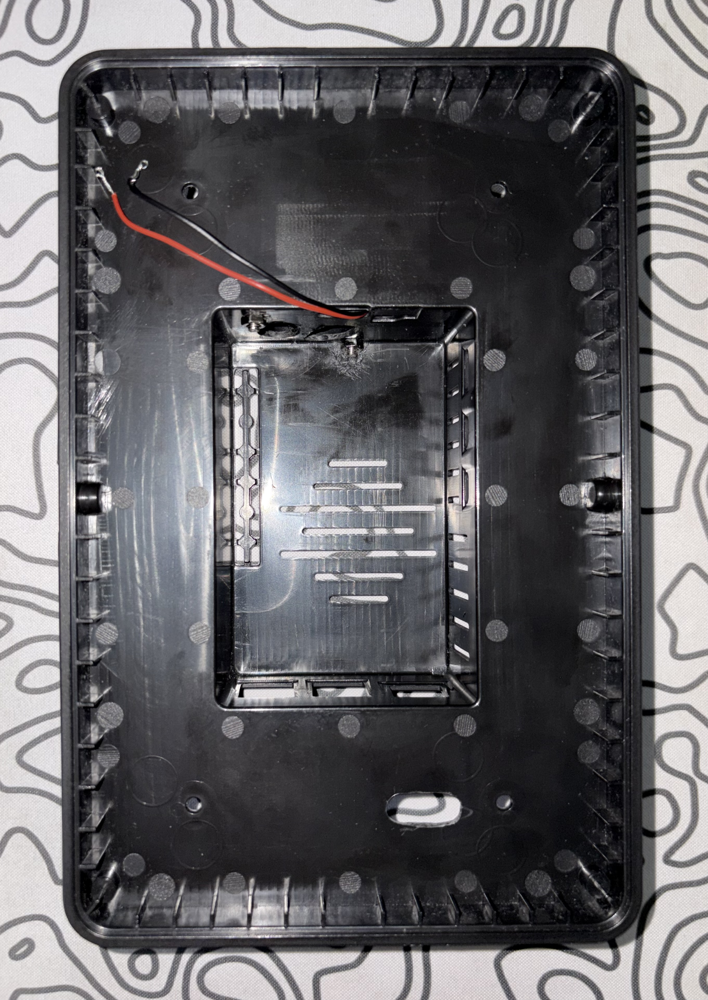


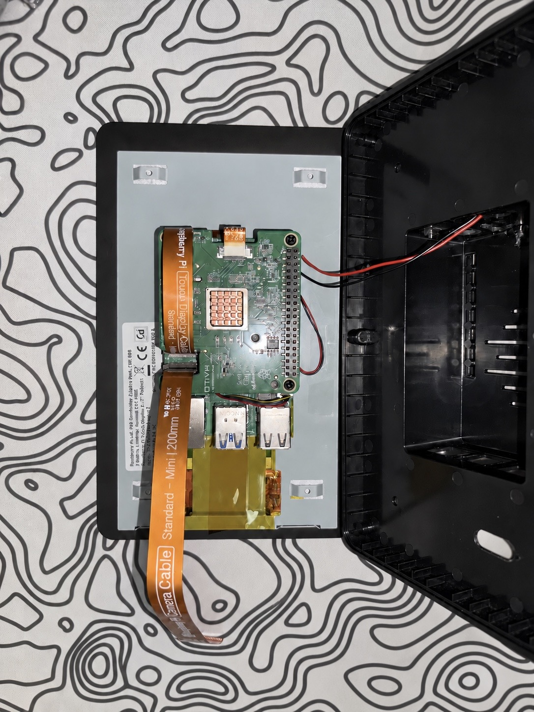

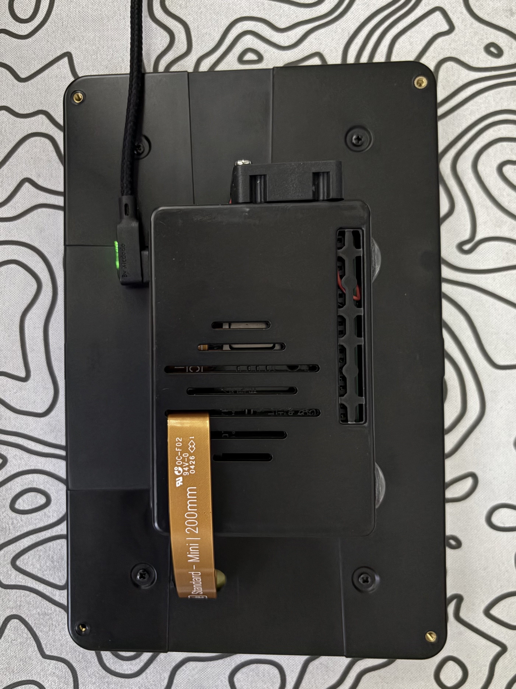

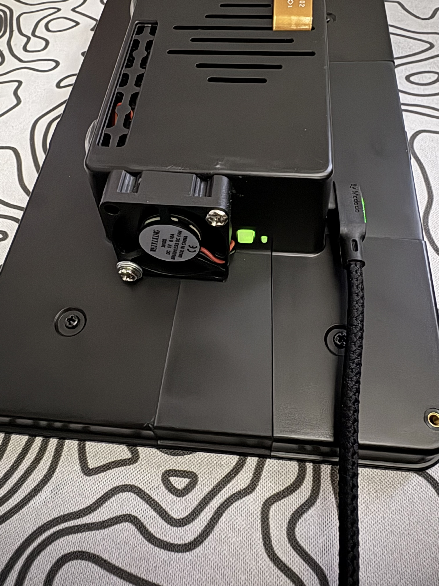

<details>
<summary>Screen --> Display Module</summary>

## 📦 Setup  
Directory Structures  
├── /usr/local/bin/touch_right_click.py  
├── ~/.config/autostart/touch-rightclick.desktop  
├  
├── /boot/firmware/config.txt  
├── /boot/firmware/cmdline.txt  
├── /etc/modprobe.d/hailo-blacklist.conf  
├── /etc/systemd/system/hailo-delayed-load.service  
├  
├── /usr/local/bin/quick-panel.py  
├  
├── /usr/local/bin/lock-sleep.sh  
├  
├── /usr/share/matchbox-keyboard/keyboard.xml  
└── ~/.config/openbox/lxde-pi-rc.xml  

```
# 1. Update the system and install all required packages for Display, Camera, and Hailo NPU
sudo apt update && sudo apt full-upgrade -y
sudo apt install --reinstall -y \
    hailo-all \
    rpicam-apps \
    libcamera-apps \
    python3-picamera2 \
    python3-libcamera \
    python3-kms++ \
    python3-numpy \
    python3-simplejpeg \
    python3-gpiozero \
    ffmpeg

# 2. Configure Camera (IMX708) access permissions and load the kernel module
sudo usermod -aG video,render,gpio $USER
sudo modprobe imx708 2>/dev/null || true
sudo chmod 666 /dev/video* /dev/media* 2>/dev/null || true

# 3. Disable early loading of Hailo at boot to prevent display conflicts
sudo rm -f /etc/modules-load.d/hailo.conf
echo "blacklist hailo_pci" | sudo tee /etc/modprobe.d/hailo-blacklist.conf > /dev/null
sudo depmod -a

# 4. Clean up any conflicting legacy systemd delayed-load service remnants
sudo systemctl disable --now hailo-delayed-load.service 2>/dev/null || true
sudo rm -f /etc/systemd/system/hailo-delayed-load.service /etc/systemd/system/graphical.target.wants/hailo-delayed-load.service /etc/systemd/system/multi-user.target.wants/hailo-delayed-load.service
sudo systemctl daemon-reload

# 5. Add a cron job to load the AI HAT driver 5 seconds after display boot
(sudo crontab -l 2>/dev/null | grep -v "hailo_pci"; echo "@reboot sleep 5 && /sbin/modprobe hailo_pci") | sudo crontab -

# 6. Load the driver in the current session and verify both Camera and Hailo NPU
sudo modprobe hailo_pci
ls -l /dev/hailo0 && hailortcli fw-control identify
rpicam-hello --list-cameras
```

```
sudo apt update  
sudo apt install -y python3-evdev python3-pynput python3-tk matchbox-keyboard xdotool xkbset light-locker
  
sudo usermod -aG input $USER  

sudo chmod 666 /sys/class/backlight/*/brightness 2>/dev/null || true

sudo chmod +x /usr/local/bin/touch_right_click.py
sudo chmod +x /usr/local/bin/quick-panel.py
sudo chmod +x /usr/local/bin/lock-sleep.sh
```
<br>

Create Brightness Panel Desktop Shortcut  
```
cat << 'EOF' > ~/Desktop/quick-panel.desktop
[Desktop Entry]
Type=Application
Name=Quick Panel
Comment=Brightness and Screen Lock Control
Exec=python3 /usr/local/bin/quick-panel.py
Icon=preferences-system
Terminal=false
Categories=Utility;Settings;
EOF

chmod +x ~/Desktop/quick-panel.desktop
# Also add to system menu:
sudo cp ~/Desktop/quick-panel.desktop /usr/share/applications/
```

auto start  
```
mkdir -p ~/.config/autostart
```

## Make persistent on every desktop launch:  
```
# Sticky Keys & Timeout Prevention
grep -qxF "xkbset accessx sticky -twokey -latchto" ~/.xsessionrc 2>/dev/null || echo "xkbset accessx sticky -twokey -latchto" >> ~/.xsessionrc
grep -qxF "xkbset exp =sticky" ~/.xsessionrc 2>/dev/null || echo "xkbset exp =sticky" >> ~/.xsessionrc

# Continuous Key Auto-Repeat
grep -qxF "xset r rate 250 35" ~/.xsessionrc 2>/dev/null || echo "xset r rate 250 35" >> ~/.xsessionrc

# Autostart Quick Panel
grep -qxF "python3 /usr/local/bin/quick-panel.py &" ~/.xsessionrc 2>/dev/null || echo "python3 /usr/local/bin/quick-panel.py &" >> ~/.xsessionrc
```

```
sudo reboot
```
<br>

## 🎉 Run  
Run Touch Movements  
```
python3 /usr/local/bin/touch_right_click.py &
```
<br>

Run Keyboard  
```
killall -9 matchbox-keyboard 2>/dev/null  
matchbox-keyboard &  
```
<br>

Run light-locker  
```
light-locker &
```
<br>

Run Brightness Panel  
```
python3 /usr/local/bin/quick-panel.py &
```
<br><br>

Touch Movements Control  
```
pgrep -af touch_right_click  
```

Apply Openbox Rules  
```
openbox --reconfigure
```

<br><br>
</details>

<details>
<summary>Screen --> Phone Screen</summary>
<details>
<summary>English</summary>

```
                                  (phone hotspot / USB tethering)
      \  |  /
       \ | /
   .---------.                    .------------------------.
   | .-----. |                    |    RASPBERRY PI 5      |
   | | VNC | |  USB Tethering     |  [VNC Server]          |
   | | App |<==================>  | USB-A <-- phone        |
   | '-----' |  (internet + VNC)  |  [AI HAT - PCIe]       |
   |   ( )   |                    '-----------+------------'
   '---------'                                |  USB-C 5V/5A
                                      .-------+-------.
                                      |   POWER BANK  |
                                      '---------------'
```

  ## 📦 Setup

Directory Structures

```
├── /boot/firmware/config.txt
├── /boot/firmware/cmdline.txt
├── /etc/modprobe.d/hailo-blacklist.conf
├── /etc/systemd/system/hailo-delayed-load.service
├
├── ~/.xsessionrc
├
├── ~/Desktop/koreader.desktop
├── ~/Desktop/rpicamgui.desktop
├── ~/Desktop/steam.desktop
├
├── /etc/apt/sources.list.d/box64.list
└── /etc/apt/sources.list.d/box86.list
```

## 👀 Overview

This setup lets you power a Raspberry Pi 5 (with AI HAT) from a **power bank**, give it internet through your phone's **USB tethering**, and then view the Pi's screen on your phone and control it by touch using **RealVNC**. No separate display module is required.

Features:

- Portable operation with a power bank
- Internet via USB tethering from the phone
- Screen viewing and touch control from the phone with RealVNC
- Headless (no monitor) usage settings
- Stable PCIe AI accelerator (Hailo) startup optimizations
- Optional apps: KOReader, RPiCamGUI, Steam

## 📋 Table of Contents

1. [Requirements](#-requirements)
2. [Setup Directory Structure](#-setup-directory-structure)
3. [Step 1: Prepare the Pi](#step-1-prepare-the-pi)
4. [Step 2: raspi-config Settings](#step-2-raspi-config-settings)
5. [Step 3: Power with the Power Bank](#step-3-power-with-the-power-bank)
6. [Step 4: USB Tethering](#step-4-usb-tethering)
7. [Step 5: Verify Internet](#step-5-verify-internet)
8. [Step 6: VNC Server](#step-6-vnc-server)
9. [Step 7: VNC Viewer on the Phone](#step-7-vnc-viewer-on-the-phone)
10. [Step 8: Touch Control](#step-8-touch-control)
11. [Step 9: AI HAT PCIe Settings](#step-9-ai-hat-pcie-settings)
12. [Step 10: Persistent Settings](#step-10-persistent-settings)
13. [Optional Apps](#-optional-apps)
14. [Quick Installation](#-quick-installation)
15. [Troubleshooting](#-troubleshooting)

---

## 🧰 Requirements

| Item | Note |
|---|---|
| Raspberry Pi 5 | Raspberry Pi OS (Bookworm, 64-bit) installed |
| AI HAT | Connected via PCIe (Hailo) |
| Power bank | **USB-C PD**, ideally 5V/5A (power demand increases with the AI HAT) |
| USB cable | A **data** cable compatible with your phone |
| Phone | Android (recommended) or iPhone |
| On the phone | **RealVNC Viewer** app |
| For first setup | Monitor + keyboard/mouse, or SSH access |

> ⚠️ The Pi 5's USB-C port is **power only**. Connect the phone to one of the Pi's **USB-A** ports.

---

## 📦 Setup Directory Structure

```
├── /boot/firmware/config.txt
├── /boot/firmware/cmdline.txt
├── /etc/modprobe.d/hailo-blacklist.conf
├── /etc/systemd/system/hailo-delayed-load.service
├
├── ~/.xsessionrc
├
├── ~/Desktop/koreader.desktop
├── ~/Desktop/rpicamgui.desktop
├── ~/Desktop/steam.desktop
├
├── /etc/apt/sources.list.d/box64.list
└── /etc/apt/sources.list.d/box86.list
```

Notes:

- `/boot/firmware/config.txt`: the lines `usb_max_current_enable=1`, `dtparam=pciex1`, `dtparam=pciex1_gen=3` and, for Steam, `kernel=kernel8.img` are added here.
- `/boot/firmware/cmdline.txt`: not modified in the steps below. Keep it only if your setup needs a Hailo-specific change there.
- `~/.xsessionrc`: holds the sticky keys and key repeat settings.
- `~/Desktop/*.desktop`, `box64.list` and `box86.list` are only created if you install the optional apps (KOReader, RPiCamGUI, Steam).

---

## Step 1: Prepare the Pi

```bash
sudo apt update && sudo apt full-upgrade -y
sudo apt install -y xkbset xdotool network-manager
sudo reboot
```

Optionally, use **Raspberry Pi Imager** to preconfigure the username, password and SSH settings when writing the SD card.

---

## Step 2: raspi-config Settings

Interactive menu:

```bash
sudo raspi-config
```

Settings to apply:

| Menu | Setting |
|---|---|
| Interface Options → VNC | **Yes** |
| Interface Options → SSH | **Yes** (optional, for backup access) |
| Display Options → VNC Resolution | **1280x720** (for headless use) |
| Display Options → Screen Blanking | **No** (so the screen doesn't blank and cut VNC) |
| Advanced Options → Wayland | **X11** (recommended for RealVNC Cloud) |
| Advanced Options → PCIe Speed | **Yes** (Gen 3, for the AI HAT) |
| System Options → Boot / Auto Login | **Desktop Autologin** |

To apply the same settings from the command line:

```bash
sudo raspi-config nonint do_vnc 0
sudo raspi-config nonint do_ssh 0
sudo raspi-config nonint do_vnc_resolution 1280x720
sudo raspi-config nonint do_blanking 1
sudo raspi-config nonint do_wayland W1
sudo raspi-config nonint do_pci 0
sudo raspi-config nonint do_boot_behaviour B4
sudo reboot
```

> ℹ️ `do_wayland W1` switches to X11. If you prefer to stay on Wayland, skip that line, but you may then need to connect by local IP instead of RealVNC Cloud.

---

## Step 3: Power with the Power Bank

1. Plug the power bank into the Pi 5's **USB-C** port.
2. If a "power supply" warning appears at boot, use a stronger PD power bank/cable.
3. If the power bank truly delivers 5A, add this to `/boot/firmware/config.txt`:

```ini
usb_max_current_enable=1
```

> 💡 During tethering the phone may try to charge from the Pi, which can drain the power bank quickly.

---

## Step 4: USB Tethering

### 🤖 Android

1. Connect the phone to the Pi's **USB-A** port with the cable.
2. Go to **Settings → Connections → Mobile Hotspot and Tethering → USB Tethering** and turn it on.

> ℹ️ Turning on only the Wi-Fi hotspot is not enough. The **USB Tethering** switch must be on.

### 🍎 iPhone

1. Connect the iPhone by cable and tap **"Trust This Computer"**.
2. Go to **Settings → Personal Hotspot → Allow Others to Join** and make sure it is on.
3. On the Pi, if needed:

```bash
sudo apt install -y usbmuxd libimobiledevice6 libimobiledevice-utils
```

---

## Step 5: Verify Internet

```bash
ip a
```

You should see a new interface such as `usb0` or `enx...` with an IP (e.g. `192.168.42.xxx`).

```bash
ping -c 3 google.com
hostname -I
```

> 🔧 If the Pi connects to a saved Wi-Fi network, turn Wi-Fi off to force traffic over USB:
> ```bash
> sudo nmcli radio wifi off
> ```

Note the IP address of the USB interface from the `hostname -I` output.

---

## Step 6: VNC Server

```bash
sudo raspi-config nonint do_vnc 0
sudo systemctl enable --now vncserver-x11-serviced
systemctl status vncserver-x11-serviced
```

### 🖥️ Headless Use (no monitor)

If no monitor is attached, VNC may show a black screen. Solutions:

- Plug in an **HDMI dummy plug**, **or**
- Set the **VNC Resolution** option in Step 2.

### ☁️ (Recommended) Cloud Connection with a RealVNC Account

1. On the Pi, click the **VNC icon** at the top right and **Sign in** with your RealVNC account.
2. You can then connect from the phone with the same account without knowing the IP.

---

## Step 7: VNC Viewer on the Phone

1. Install the **RealVNC Viewer** app (Play Store / App Store).
2. **Method A: Direct IP**
   - Tap **+** to create a new connection.
   - Address: the Pi IP you noted in Step 5 (e.g. `192.168.42.123`)
   - Username and password: your Pi OS credentials.
3. **Method B: Cloud**
   - Sign in to the app with the same RealVNC account.
   - The Pi appears in the list; tap to connect.

---

## Step 8: Touch Control

In VNC Viewer (settings/toolbar) you can choose the input mode:

| Mode | Behavior |
|---|---|
| **Touchscreen** | Taps exactly where you touch |
| **Trackpad** | Move the cursor with your finger, tap to click |

Common gestures:

- **Single tap** → Left click
- **Long press** → Right click
- **Two-finger swipe** → Scroll
- **Pinch** → Zoom in/out
- **Keyboard icon** → Type using the phone's on-screen keyboard

---

## Step 9: AI HAT PCIe Settings

Install the Hailo packages:

```bash
sudo apt install -y hailo-all
```

Add to `/boot/firmware/config.txt`:

```ini
dtparam=pciex1
dtparam=pciex1_gen=3
```

Prevent the Hailo driver from loading automatically at boot (so it loads after power and tethering have settled):

```bash
echo "blacklist hailo_pci" | sudo tee /etc/modprobe.d/hailo-blacklist.conf
```

Create the delayed load service:

```bash
sudo tee /etc/systemd/system/hailo-delayed-load.service > /dev/null << 'EOF'
[Unit]
Description=Delayed Hailo PCIe module load
After=multi-user.target

[Service]
Type=oneshot
ExecStartPre=/bin/sleep 15
ExecStart=/sbin/modprobe hailo_pci

[Install]
WantedBy=multi-user.target
EOF

sudo systemctl daemon-reload
sudo systemctl enable hailo-delayed-load.service
```

Reboot and verify:

```bash
sudo reboot
hailortcli fw-control identify
```

> ⚠️ If the power bank is insufficient, the AI HAT may cause problems at boot. Use a 5V/5A PD-capable power bank.

---

## Step 10: Persistent Settings

Settings applied on every desktop launch:

```bash
# Sticky Keys (makes Ctrl/Alt combinations easier over VNC)
grep -qxF "xkbset accessx sticky -twokey -latchto" ~/.xsessionrc 2>/dev/null || echo "xkbset accessx sticky -twokey -latchto" >> ~/.xsessionrc
grep -qxF "xkbset exp =sticky" ~/.xsessionrc 2>/dev/null || echo "xkbset exp =sticky" >> ~/.xsessionrc

# Continuous key auto-repeat
grep -qxF "xset r rate 250 35" ~/.xsessionrc 2>/dev/null || echo "xset r rate 250 35" >> ~/.xsessionrc
```

To make the USB tethering connection come up automatically (check the connection name with `nmcli con show`):

```bash
nmcli con show
sudo nmcli con modify "Wired connection 1" connection.autoconnect yes
```

```bash
sudo reboot
```

---

## ⚡ Quick Installation

Download the project to the Pi and run the install script (replace `USER/REPO` with your own repository):

```bash
sudo apt install -y git
git clone https://github.com/USER/REPO.git
cd REPO
chmod +x install.sh
./install.sh
```

---

## 🛠️ Troubleshooting

| Problem | Solution |
|---|---|
| Pi doesn't detect the phone | Use a data-capable cable, try a different USB-A port |
| No `usb0` interface | Toggle tethering off and on, check `dmesg \| tail` |
| Internet works but VNC won't connect by IP | Use the **Cloud** method, check `systemctl status vncserver-x11-serviced` |
| Black screen in VNC | HDMI dummy plug or set VNC resolution (Step 2) |
| Pi doesn't appear in VNC Cloud | Switch to X11 with `sudo raspi-config nonint do_wayland W1` |
| Pi keeps rebooting | Power bank/cable insufficient, use 5V/5A PD |
| `hailortcli` can't find the device | Check the card with `lspci`, verify the `dtparam=pciex1` line, check power sufficiency |
| IP changes every time | Use Cloud connection or re-check with `hostname -I` |

---

## ✅ Quick Summary

```text
1. Power bank -> Pi 5 (USB-C)
2. Phone -> Pi 5 (USB-A), USB Tethering ON
3. raspi-config: VNC, resolution, X11, PCIe, blanking off
4. Pi: ping google.com + hostname -I
5. Phone: RealVNC Viewer -> connect via IP or Cloud
6. Control with Touchscreen/Trackpad mode 🎉
```
</details>

<details>
<summary>Turkce</summary>

```
                                  (telefon hotspot / USB tethering)
      \  |  /
       \ | /
   .---------.                    .------------------------.
   | .-----. |                    |    RASPBERRY PI 5      |
   | | VNC | |  USB Tethering     |  [VNC Server]          |
   | | App |<==================>  | USB-A <-- telefon      |
   | '-----' |  (internet + VNC)  |  [AI HAT - PCIe]       |
   |   ( )   |                    '-----------+------------'
   '---------'                                |  USB-C 5V/5A
                                      .-------+-------.
                                      |   POWERBANK   |
                                      '---------------'
```

## 📦 Kurulum

Dizin Yapıları

```
├── /boot/firmware/config.txt
├── /boot/firmware/cmdline.txt
├── /etc/modprobe.d/hailo-blacklist.conf
├── /etc/systemd/system/hailo-delayed-load.service
├
├── ~/.xsessionrc
├
├── ~/Desktop/koreader.desktop
├── ~/Desktop/rpicamgui.desktop
├── ~/Desktop/steam.desktop
├
├── /etc/apt/sources.list.d/box64.list
└── /etc/apt/sources.list.d/box86.list
```

## 👀 Genel Bakış

Bu kurulum, Raspberry Pi 5'i (AI HAT ile birlikte) **powerbank** ile çalıştırıp internetini telefonun **USB tethering** özelliğinden almasını, ardından **RealVNC** ile Pi ekranını telefonda görüp dokunarak kontrol etmeyi sağlar. Ayrı bir ekran modülü gerekmez.

Özellikler:

- Powerbank ile taşınabilir çalışma
- Telefondan USB tethering ile internet
- RealVNC ile telefondan ekran görüntüsü ve dokunmatik kontrol
- Monitörsüz (headless) kullanım ayarları
- Kararlı PCIe AI hızlandırıcı (Hailo) başlatma ayarları
- İsteğe bağlı uygulamalar: KOReader, RPiCamGUI, Steam

## 📋 İçindekiler

1. [Gereksinimler](#-gereksinimler)
2. [Kurulum Dosya Yapısı](#-kurulum-dosya-yapısı)
3. [Adım 1: Pi'yi Hazırla](#adım-1-pi-yi-hazırla)
4. [Adım 2: raspi-config Ayarları](#adım-2-raspi-config-ayarları)
5. [Adım 3: Powerbank ile Besle](#adım-3-powerbank-ile-besle)
6. [Adım 4: USB Tethering](#adım-4-usb-tethering)
7. [Adım 5: İnterneti Doğrula](#adım-5-i̇nterneti-doğrula)
8. [Adım 6: VNC Server](#adım-6-vnc-server)
9. [Adım 7: Telefonda VNC Viewer](#adım-7-telefonda-vnc-viewer)
10. [Adım 8: Dokunmatik Kontrol](#adım-8-dokunmatik-kontrol)
11. [Adım 9: AI HAT PCIe Ayarları](#adım-9-ai-hat-pcie-ayarları)
12. [Adım 10: Kalıcı Ayarlar](#adım-10-kalıcı-ayarlar)
13. [İsteğe Bağlı Uygulamalar](#-i̇steğe-bağlı-uygulamalar)
14. [Hızlı Kurulum](#-hızlı-kurulum)
15. [Sorun Giderme](#-sorun-giderme)

---

## 🧰 Gereksinimler

| Parça | Not |
|---|---|
| Raspberry Pi 5 | Raspberry Pi OS (Bookworm, 64-bit) kurulu olmalı |
| AI HAT | PCIe üzerinden bağlı (Hailo) |
| Powerbank | **USB-C PD**, mümkünse 5V/5A (AI HAT ile çalışırken güç ihtiyacı artar) |
| USB kablo | Telefona uygun **veri** kablosu |
| Telefon | Android (önerilen) veya iPhone |
| Telefonda | **RealVNC Viewer** uygulaması |
| İlk kurulum için | Monitör + klavye/fare veya SSH erişimi |

> ⚠️ Pi 5'in USB-C portu **sadece güç** içindir. Telefonu Pi'nin **USB-A** portlarından birine bağlayın.

---

## 📦 Kurulum Dosya Yapısı

```
├── /boot/firmware/config.txt
├── /boot/firmware/cmdline.txt
├── /etc/modprobe.d/hailo-blacklist.conf
├── /etc/systemd/system/hailo-delayed-load.service
└── ~/.xsessionrc
```

---

## Adım 1: Pi'yi Hazırla

```bash
sudo apt update && sudo apt full-upgrade -y
sudo apt install -y xkbset xdotool network-manager
sudo reboot
```

İsterseniz **Raspberry Pi Imager** ile SD karta yazarken kullanıcı adı, şifre ve SSH ayarlarını önceden yapabilirsiniz.

---

## Adım 2: raspi-config Ayarları

Etkileşimli menü:

```bash
sudo raspi-config
```

Yapılacak ayarlar:

| Menü | Ayar |
|---|---|
| Interface Options → VNC | **Yes** |
| Interface Options → SSH | **Yes** (isteğe bağlı, yedek erişim için) |
| Display Options → VNC Resolution | **1280x720** (monitörsüz kullanım için) |
| Display Options → Screen Blanking | **No** (ekran kararıp VNC'yi kesmesin) |
| Advanced Options → Wayland | **X11** (RealVNC Cloud için önerilir) |
| Advanced Options → PCIe Speed | **Yes** (Gen 3, AI HAT için) |
| System Options → Boot / Auto Login | **Desktop Autologin** |

Aynı ayarları komutla yapmak için:

```bash
sudo raspi-config nonint do_vnc 0
sudo raspi-config nonint do_ssh 0
sudo raspi-config nonint do_vnc_resolution 1280x720
sudo raspi-config nonint do_blanking 1
sudo raspi-config nonint do_wayland W1
sudo raspi-config nonint do_pci 0
sudo raspi-config nonint do_boot_behaviour B4
sudo reboot
```

> ℹ️ `do_wayland W1` X11'e geçer. Wayland'de kalmak isterseniz bu satırı atlayın, ancak o zaman RealVNC Cloud yerine yerel IP ile bağlanmanız gerekebilir.

---

## Adım 3: Powerbank ile Besle

1. Powerbank'i Pi 5'in **USB-C** portuna takın.
2. Açılışta "power supply" uyarısı çıkarsa daha güçlü bir PD powerbank/kablo kullanın.
3. Powerbank gerçekten 5A veriyorsa `/boot/firmware/config.txt` dosyasına ekleyin:

```ini
usb_max_current_enable=1
```

> 💡 Telefon, tethering sırasında Pi'den şarj olmaya çalışabilir ve powerbank'i hızlı tüketebilir.

---

## Adım 4: USB Tethering

### 🤖 Android

1. Telefonu Pi'nin **USB-A** portuna kabloyla bağlayın.
2. **Ayarlar → Bağlantılar → Mobil Hotspot ve Bağlantı Paylaşımı → USB Tethering** seçeneğini açın.

> ℹ️ Sadece Wi-Fi hotspot'u açmak yeterli değildir, **USB Tethering** anahtarı açık olmalıdır.

### 🍎 iPhone

1. iPhone'u kabloyla bağlayın, **"Bu Bilgisayara Güven"** deyin.
2. **Ayarlar → Kişisel Hotspot → Diğerlerinin Katılmasına İzin Ver** açık olsun.
3. Pi'de gerekirse:

```bash
sudo apt install -y usbmuxd libimobiledevice6 libimobiledevice-utils
```

---

## Adım 5: İnterneti Doğrula

```bash
ip a
```

`usb0` veya `enx...` gibi yeni bir arayüz ve IP (ör. `192.168.42.xxx`) görmelisiniz.

```bash
ping -c 3 google.com
hostname -I
```

> 🔧 Pi kayıtlı bir Wi-Fi'ye bağlanıyorsa trafiği USB üzerinden zorlamak için Wi-Fi'yi kapatın:
> ```bash
> sudo nmcli radio wifi off
> ```

`hostname -I` çıktısındaki USB arayüzünün IP adresini not alın.

---

## Adım 6: VNC Server

```bash
sudo raspi-config nonint do_vnc 0
sudo systemctl enable --now vncserver-x11-serviced
systemctl status vncserver-x11-serviced
```

### 🖥️ Monitörsüz (headless) kullanım

Monitör takılı değilse VNC siyah ekran verebilir. Çözümler:

- Bir **HDMI dummy plug** takın, **ya da**
- Adım 2'deki **VNC Resolution** ayarını yapın.

### ☁️ (Önerilen) RealVNC hesabı ile Cloud bağlantısı

1. Pi'de sağ üstteki **VNC simgesine** tıklayıp RealVNC hesabınızla **Sign in** yapın.
2. Böylece IP bilmeden, aynı hesapla telefondan bağlanabilirsiniz.

---

## Adım 7: Telefonda VNC Viewer

1. Telefona **RealVNC Viewer** uygulamasını kurun (Play Store / App Store).
2. **Yöntem A: Doğrudan IP**
   - **+** ile yeni bağlantı oluşturun.
   - Adres: Adım 5'te not ettiğiniz Pi IP'si (ör. `192.168.42.123`)
   - Kullanıcı adı ve şifre: Pi OS kullanıcı bilgileriniz.
3. **Yöntem B: Cloud**
   - Uygulamada aynı RealVNC hesabıyla giriş yapın.
   - Pi listede görünür, dokunup bağlanın.

---

## Adım 8: Dokunmatik Kontrol

VNC Viewer'da (ayarlar/araç çubuğundan) giriş modunu seçebilirsiniz:

| Mod | Davranış |
|---|---|
| **Touchscreen** | Dokunduğunuz yere tıklar |
| **Trackpad** | Parmakla imleci hareket ettirirsiniz, dokunarak tıklarsınız |

Genel hareketler:

- **Tek dokunuş** → Sol tık
- **Uzun basma** → Sağ tık
- **İki parmakla kaydırma** → Scroll
- **İki parmakla sıkıştırma** → Yakınlaştır/uzaklaştır
- **Klavye simgesi** → Telefonun ekran klavyesi ile yazı yazma

---

## Adım 9: AI HAT PCIe Ayarları

Hailo paketlerini kurun:

```bash
sudo apt install -y hailo-all
```

`/boot/firmware/config.txt` dosyasına ekleyin:

```ini
dtparam=pciex1
dtparam=pciex1_gen=3
```

Hailo sürücüsünü açılışta otomatik yüklemeyi engelleyin (güç ve tethering oturduktan sonra yüklenmesi için):

```bash
echo "blacklist hailo_pci" | sudo tee /etc/modprobe.d/hailo-blacklist.conf
```

Gecikmeli yükleme servisi oluşturun:

```bash
sudo tee /etc/systemd/system/hailo-delayed-load.service > /dev/null << 'EOF'
[Unit]
Description=Delayed Hailo PCIe module load
After=multi-user.target

[Service]
Type=oneshot
ExecStartPre=/bin/sleep 15
ExecStart=/sbin/modprobe hailo_pci

[Install]
WantedBy=multi-user.target
EOF

sudo systemctl daemon-reload
sudo systemctl enable hailo-delayed-load.service
```

Yeniden başlatıp doğrulayın:

```bash
sudo reboot
hailortcli fw-control identify
```

> ⚠️ Powerbank yetersizse AI HAT açılışta sorun çıkarabilir. 5V/5A PD destekli powerbank kullanın.

---

## Adım 10: Kalıcı Ayarlar

Her masaüstü açılışında uygulanacak ayarlar:

```bash
# Sticky Keys (VNC'de Ctrl/Alt kombinasyonlarını kolaylaştırır)
grep -qxF "xkbset accessx sticky -twokey -latchto" ~/.xsessionrc 2>/dev/null || echo "xkbset accessx sticky -twokey -latchto" >> ~/.xsessionrc
grep -qxF "xkbset exp =sticky" ~/.xsessionrc 2>/dev/null || echo "xkbset exp =sticky" >> ~/.xsessionrc

# Sürekli tuş tekrarı
grep -qxF "xset r rate 250 35" ~/.xsessionrc 2>/dev/null || echo "xset r rate 250 35" >> ~/.xsessionrc
```

USB tethering bağlantısının otomatik gelmesi için (bağlantı adını `nmcli con show` ile kontrol edin):

```bash
nmcli con show
sudo nmcli con modify "Wired connection 1" connection.autoconnect yes
```

```bash
sudo reboot
```

---

## ⚡ Hızlı Kurulum

Projeyi Pi'ye indirip kurulum scriptini çalıştırın (`KULLANICI/REPO` kısmını kendi deponuzla değiştirin):

```bash
sudo apt install -y git
git clone https://github.com/KULLANICI/REPO.git
cd REPO
chmod +x install.sh
./install.sh
```

---

## 🛠️ Sorun Giderme

| Sorun | Çözüm |
|---|---|
| Pi telefonu görmüyor | Veri destekli kablo kullanın, farklı USB-A portu deneyin |
| `usb0` yok | Tethering'i kapatıp açın, `dmesg \| tail` ile kontrol edin |
| İnternet var ama VNC IP ile bağlanmıyor | **Cloud** yöntemini kullanın, `systemctl status vncserver-x11-serviced` kontrol edin |
| VNC'de siyah ekran | HDMI dummy plug veya VNC çözünürlüğü ayarlayın (Adım 2) |
| VNC Cloud'da Pi görünmüyor | `sudo raspi-config nonint do_wayland W1` ile X11'e geçin |
| Pi sürekli yeniden başlıyor | Powerbank/kablo yetersiz, 5V/5A PD kullanın |
| `hailortcli` cihazı bulamıyor | `lspci` ile kartı kontrol edin, `dtparam=pciex1` satırını doğrulayın, güç yeterliliğine bakın |
| IP her seferinde değişiyor | Cloud bağlantı kullanın veya `hostname -I` ile yeniden bakın |

---

## ✅ Hızlı Özet

```text
1. Powerbank -> Pi 5 (USB-C)
2. Telefon -> Pi 5 (USB-A), USB Tethering AÇIK
3. raspi-config: VNC, çözünürlük, X11, PCIe, blanking kapalı
4. Pi: ping google.com + hostname -I
5. Telefon: RealVNC Viewer -> IP veya Cloud ile bağlan
6. Touchscreen/Trackpad moduyla kontrol et 🎉
```
</details>
</details>

### 📖 KOReader

A versatile, gesture-driven document and e-book reader optimized for touchscreens and e-ink displays. It offers seamless rendering for EPUB, PDF, DJVU, CBZ, and FB2 formats, featuring advanced text reflow for PDFs, full typographic customization, and a lightweight footprint ideal for low-power ARM devices.

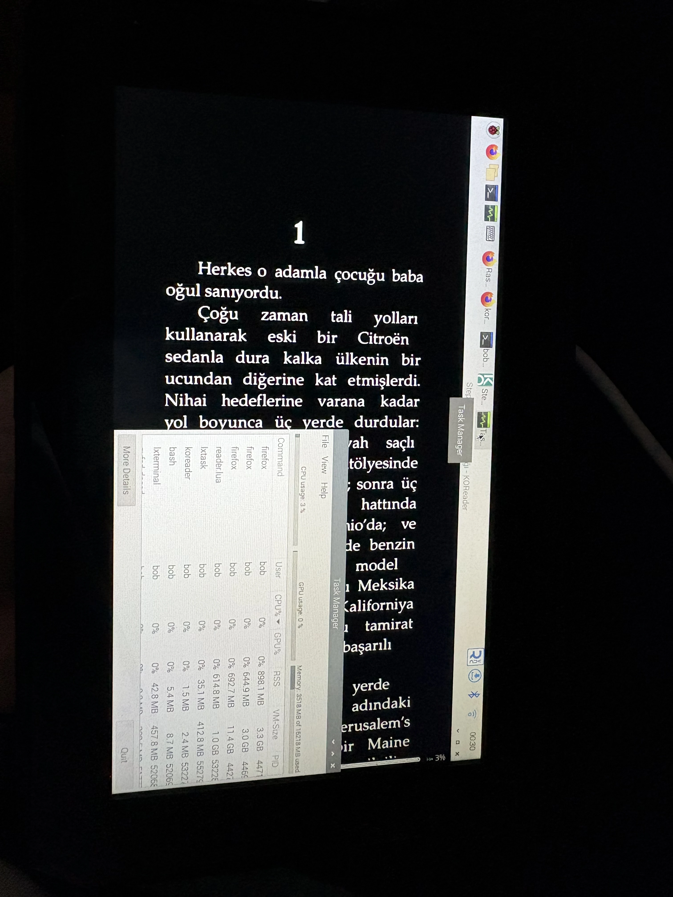
<details>
<summary>KOReader</summary>

#### Installation & Setup

```bash
# 1. Fetch the latest ARM64 .deb release URL and download it
URL=$(curl -s [https://api.github.com/repos/koreader/koreader/releases/latest](https://api.github.com/repos/koreader/koreader/releases/latest) | grep "browser_download_url.*arm64.*\.deb" | cut -d '"' -f 4 | head -n 1)
wget -O koreader.deb "$URL"

# 2. Install the package
sudo dpkg -i koreader.deb

# 3. Resolve and install missing dependencies
sudo apt install -f -y

# 4. Clean up the downloaded installer
rm -f koreader.deb


cat << 'EOF' > ~/Desktop/koreader.desktop
[Desktop Entry]
Type=Application
Name=KOReader
Comment=E-Book Reader
Exec=koreader -w 800x600
Icon=accessories-dictionary
Terminal=false
Categories=Office;Viewer;
EOF
```

Run  
```
koreader &
```
</details>


### 📷 RPiCamGUI

Lightweight touch-friendly graphical user interface designed for Raspberry Pi camera modules (such as Camera Module 3 / IMX708). Provides real-time preview, digital zoom controls, and fast parameter tuning directly on the display.

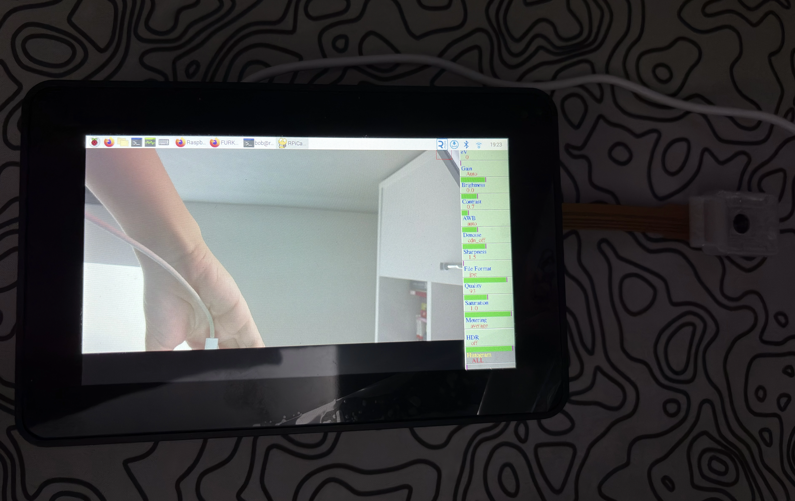
<details>
<summary>Installation & Setup</summary>

#### 1. System Dependencies & Environment Setup
Raspberry Pi OS (Bookworm) uses PEP 668 (`externally-managed-environment`), so all GUI and runtime dependencies must be installed via APT:

```bash
# Update repositories and install native GUI/camera packages
sudo apt update
sudo apt install -y git python3-pygame python3-pip python3-pyqt5 python3-opencv libcamera-tools

cd ~
git clone [https://github.com/Gordon999/RPiCamGUI.git](https://github.com/Gordon999/RPiCamGUI.git)
cd RPiCamGUI
chmod +x RPiCamGUI.py
sudo usermod -aG gpio,video,render $USER


cat << 'EOF' > ~/Desktop/rpicamgui.desktop
[Desktop Entry]
Type=Application
Name=RPi Cam GUI
Comment=Touchscreen Camera Controller
Exec=/bin/sh -c "python3 $HOME/RPiCamGUI/RPiCamGUI.py"
Icon=camera-photo
Terminal=false
Categories=AudioVideo;Video;
EOF

chmod +x ~/Desktop/rpicamgui.desktop
sudo cp ~/Desktop/rpicamgui.desktop /usr/share/applications/
```

Run  
```
python3 ~/RPiCamGUI/RPiCamGUI.py
```
</details>


### 🎮 Steam Client (via Box64 / Box86)

Runs Valve's x86 Steam client on the ARM64 architecture of the Raspberry Pi 5 using dynamic binary translation layers.


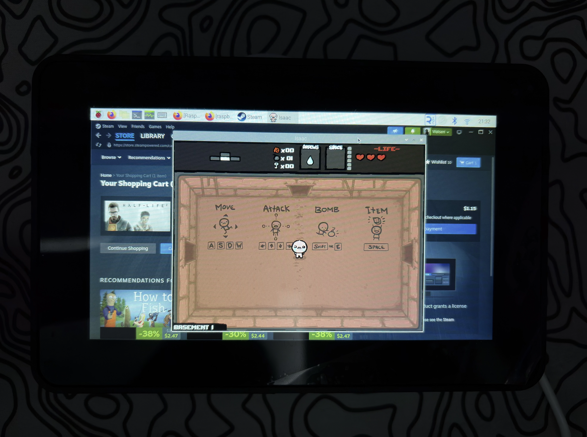
<details>
<summary>Installation & Setup</summary>

#### 1. Switch Kernel to 4K Page Size (Mandatory)
The Raspberry Pi 5 kernel defaults to a 16 KB page size (`kernel_2712.img`), causing 32-bit x86/ARM shared libraries (`libm.so.6`) to crash with `ELF load command address/offset not page-aligned`. You must force the standard 4K-paged 64-bit kernel:

```bash
# Enforce standard 4KB page kernel
echo "kernel=kernel8.img" | sudo tee -a /boot/firmware/config.txt
sudo reboot

getconf PAGESIZE

# Enable 32-bit ARM architecture
sudo dpkg --add-architecture armhf

# Add Box64 and Box86 APT sources and GPG keys
sudo wget [https://ryanfortner.github.io/box64-debs/box64.list](https://ryanfortner.github.io/box64-debs/box64.list) -O /etc/apt/sources.list.d/box64.list
sudo wget [https://ryanfortner.github.io/box86-debs/box86.list](https://ryanfortner.github.io/box86-debs/box86.list) -O /etc/apt/sources.list.d/box86.list
wget -qO- [https://ryanfortner.github.io/box64-debs/KEY.gpg](https://ryanfortner.github.io/box64-debs/KEY.gpg) | gpg --dearmor | sudo tee /etc/apt/trusted.gpg.d/box64-debs-archive-keyring.gpg > /dev/null

# Update and install translation layers with graphics runtimes
sudo apt update
sudo apt install -y box64-rpi5arm64 box86-generic-arm:armhf libgl1-mesa-dri:armhf libgl1-mesa-glx:armhf


cd ~
wget [https://raw.githubusercontent.com/ptitSeb/box86/master/install_steam.sh](https://raw.githubusercontent.com/ptitSeb/box86/master/install_steam.sh)
chmod +x install_steam.sh
./install_steam.sh

cat << 'EOF' > ~/Desktop/steam.desktop
[Desktop Entry]
Type=Application
Name=Steam
Comment=Application for managing and playing games on Steam
Exec=/usr/local/bin/steam %U
Icon=steam
Terminal=false
Categories=Game;
EOF

chmod +x ~/Desktop/steam.desktop
```

Run  
```
steam &
```
</details>

## 🎮 Gaming Performance

Tweaks for getting the best possible performance out of games on the Pi 5 (Box64 / Box86 / Wine). No AI acceleration is involved here, only system-level tuning.

> ⚠️ Cooling and power matter more than any setting below. Use an active cooler and a real 5V/5A PD supply. Check for throttling with `vcgencmd get_throttled` (`0x0` means no problems).

> ℹ️ Over the phone (VNC) option, games will have noticeable latency and low FPS. Prefer lightweight or 2D games, or use a display module / HDMI screen for real gaming.

### 1. CPU Governor: performance

Keeps the CPU at its maximum frequency instead of scaling down during games.

```bash
sudo tee /etc/systemd/system/cpu-performance.service > /dev/null << 'EOF'
[Unit]
Description=Set CPU governor to performance
After=multi-user.target

[Service]
Type=oneshot
ExecStart=/bin/sh -c 'for g in /sys/devices/system/cpu/cpu*/cpufreq/scaling_governor; do echo performance > $g; done'
RemainAfterExit=yes

[Install]
WantedBy=multi-user.target
EOF

sudo systemctl daemon-reload
sudo systemctl enable --now cpu-performance.service
```

Verify:

```bash
cat /sys/devices/system/cpu/cpu0/cpufreq/scaling_governor
```

To revert:

```bash
sudo systemctl disable --now cpu-performance.service
```

### 2. GameMode and MangoHud

`gamemode` applies CPU optimizations while a game runs. `mangohud` shows FPS, CPU/GPU load and temperature.

```bash
sudo apt install -y gamemode mangohud
sudo usermod -aG gamemode $USER
```

Usage in Steam launch options:

```
gamemoderun mangohud %command%
```

> ℹ️ Games running through Box64/Box86 are x86 binaries. MangoHud (arm64) may not hook into them, so for those games rely on `vcgencmd measure_temp` and `htop` instead. GameMode works at the system level and is still useful.

Monitor temperature and throttling in a second terminal:

```bash
watch -n 1 "vcgencmd measure_temp; vcgencmd get_throttled; vcgencmd measure_clock arm"
```

### 3. Box64 Performance Settings

Box64 settings can be applied globally or per game. Aggressive options speed things up but can break some games, so **apply them per game** and test.

Create or edit `/etc/box64.box64rc`:

```bash
sudo nano /etc/box64.box64rc
```

Example profile (replace the section name with the game's executable name, without `.exe` case changes):

```ini
[hl2_linux]
BOX64_DYNAREC_BIGBLOCK=2
BOX64_DYNAREC_FASTNAN=1
BOX64_DYNAREC_FASTROUND=1
BOX64_DYNAREC_CALLRET=1
```

Or test quickly with environment variables, before making them permanent:

```bash
BOX64_DYNAREC_BIGBLOCK=2 BOX64_DYNAREC_FASTNAN=1 BOX64_DYNAREC_FASTROUND=1 BOX64_DYNAREC_CALLRET=1 box64 ./game
```

Or in Steam launch options:

```
BOX64_DYNAREC_BIGBLOCK=2 BOX64_DYNAREC_FASTNAN=1 BOX64_DYNAREC_FASTROUND=1 %command%
```

| Variable | Effect |
|---|---|
| `BOX64_DYNAREC_BIGBLOCK` | Larger translated code blocks, faster but riskier at higher values |
| `BOX64_DYNAREC_FASTNAN` | Faster float NaN handling, can break precision-sensitive games |
| `BOX64_DYNAREC_FASTROUND` | Faster float rounding, can cause glitches in some games |
| `BOX64_DYNAREC_CALLRET` | Optimizes call/return handling |

> ℹ️ Option names and values change between Box64 versions. Check the official documentation for your installed version if something does not work.

### 4. Mesa / V3D Driver Check

The Pi 5 GPU (V3D 7.1) runs on Mesa. Make sure the graphics stack is installed and up to date:

```bash
sudo apt update
sudo apt install -y mesa-utils mesa-vulkan-drivers vulkan-tools libgl1-mesa-dri libglx-mesa0
sudo apt full-upgrade -y
```

Verify:

```bash
glxinfo -B | grep -E "renderer|OpenGL version"
vulkaninfo --summary
```

The renderer should mention `V3D 7.1`. If it says `llvmpipe`, the GPU driver is not active (software rendering).

> ℹ️ Native x86_64 games use the libraries bundled in the Steam runtime. If a game reports missing graphics libraries, install the needed x86_64 packages through the Box64 environment you use.

### 5. Windows Games with Wine (via Box64)

x86_64 Wine runs through Box64. Proton-GE does **not** work directly on ARM, so use plain Wine.

Install the prerequisites:

```bash
sudo apt install -y cabextract p7zip-full unzip winetricks
```

Download an x86_64 Wine build (check the latest release at https://github.com/Kron4ek/Wine-Builds/releases and set `WINE_VER` accordingly):

```bash
cd ~
WINE_VER="9.0"   # example, replace with the latest version you want
wget "https://github.com/Kron4ek/Wine-Builds/releases/download/${WINE_VER}/wine-${WINE_VER}-amd64.tar.xz"
tar -xf wine-${WINE_VER}-amd64.tar.xz
mv wine-${WINE_VER}-amd64 ~/wine
rm -f wine-${WINE_VER}-amd64.tar.xz
```

Create launcher wrappers:

```bash
sudo tee /usr/local/bin/wine64 > /dev/null << 'EOF'
#!/bin/bash
exec box64 "$HOME/wine/bin/wine64" "$@"
EOF

sudo tee /usr/local/bin/wineserver > /dev/null << 'EOF'
#!/bin/bash
exec box64 "$HOME/wine/bin/wineserver" "$@"
EOF

sudo chmod +x /usr/local/bin/wine64 /usr/local/bin/wineserver
```

Initialize the Wine prefix and run a program:

```bash
export WINEPREFIX=$HOME/.wine64
export WINEARCH=win64
wine64 wineboot --init
wine64 /path/to/game.exe
```

Install common components with Winetricks (optional):

```bash
WINE=/usr/local/bin/wine64 winetricks corefonts vcrun2019
```

#### DXVK vs WineD3D

| Renderer | Notes |
|---|---|
| **WineD3D** (default) | Translates DirectX to OpenGL. Slower but the most compatible |
| **DXVK** | Translates DirectX 9/10/11 to Vulkan. Faster when it works, but V3DV Vulkan support is limited, so many games fail |

Try WineD3D first. To test DXVK:

```bash
WINE=/usr/local/bin/wine64 winetricks dxvk
```

To go back to WineD3D:

```bash
WINE=/usr/local/bin/wine64 winetricks --force d3d9 d3d10core d3d11 dxgi
```

### 6. ZRAM and Swap Tuning

Compressed RAM swap reduces stuttering when memory fills up. Steam and games use RAM quickly.

```bash
sudo apt install -y zram-tools
```

Configure:

```bash
sudo tee /etc/default/zramswap > /dev/null << 'EOF'
ALGO=zstd
PERCENT=50
PRIORITY=100
EOF

sudo systemctl restart zramswap
```

Set swappiness (a higher value is normal when swap lives in compressed RAM):

```bash
echo "vm.swappiness=100" | sudo tee /etc/sysctl.d/99-swappiness.conf
sudo sysctl --system
```

Verify:

```bash
swapon --show
free -h
cat /proc/sys/vm/swappiness
```

> ℹ️ ZRAM helps most on 4 GB / 8 GB models. If you run games from an SD card, loading will still be slow. A USB 3.0 SSD is strongly recommended.


# Fast Installation  

```
sudo pacman -Syu git  
git clone https://github.com/FURK4NGG/raspberry-pi5_ai-hat_display-module2.git  
cd raspberry-pi5_ai-hat_display-module2  
chmod +x install.sh  
./install.sh  
```

## 🔒 License  
<h1 align="center">📜 GPL-3.0 License</h1>
